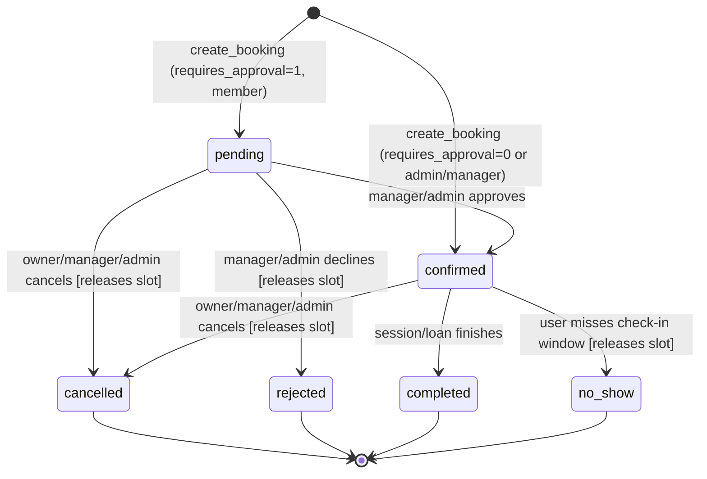
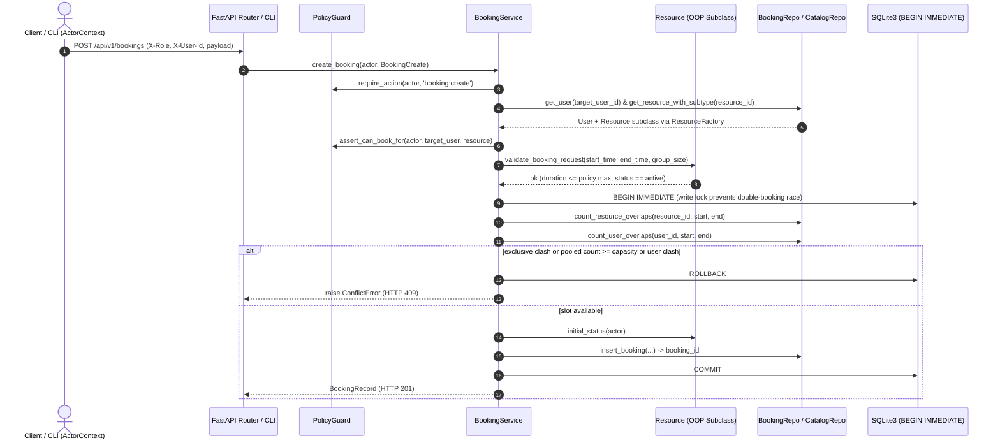

# Requirements, Use Cases & Core Flows

## 1. Functional Requirements (FR)

| ID        | Requirement                                                                                                                                                                                                                               | Target Actors                          | Verification                     |
| :--------- | :----------------------------------------------------------------------------------------------------------------------------------------------------------------------------------------------------------------------------------------- | :-------------------------------------- | :-------------------------------- |
| **FR-01** | Manage campus catalogue: create, view, filter, update, and soft-retire `departments`, `buildings`, `users`, `resources` (CTI subtypes), and `facilities`.                                                                                 | `admin`, `manager`                     | `test_catalog_crud.py`           |
| **FR-02** | Browse & search resources by `resource_type`, `zone`, `building_id`, `department_id`, `min_capacity`, `facility`, and `status`, automatically filtered to eligible resources for `member` via Policy-to-SQL pushdown.                     | All                                    | `test_policy_and_privacy.py`     |
| **FR-03** | Check real-time slot availability (`GET /api/v1/availability`) for any UTC Unix window `[start_time, end_time)` using each resource subtype's concurrency limit (`1` for rooms, `quantity` for equipment, `max_attendees` for support).   | All                                    | `test_bookings_and_conflicts.py` |
| **FR-04** | Create bookings with 2-way overlap prevention (subtype concurrency limit + user double-booking), configurable duration limits (`BookingPolicyConfig`), and automatic `pending` vs `confirmed` state selection.                            | `admin`, `manager`, `member`           | `test_bookings_and_conflicts.py` |
| **FR-05** | Approve or reject `pending` requests, reschedule existing bookings (re-running full conflict & duration validation), and transition bookings to `cancelled`, `completed`, or `no_show`.                                                   | `admin`, `manager`, owner `member`     | `test_bookings_and_conflicts.py` |
| **FR-06** | Soft-delete bookings (`deleted_at`), retire resources (`status='retired'`), and deactivate users (`is_active=0`)—preserving historical integrity and auditability (zero hard deletes).                                                    | `admin`                                | `test_bookings_and_conflicts.py` |
| **FR-07** | Seed deterministic campus data from `database/catalog.json` + synthetic multi-week bookings, and support CSV batch import with line-numbered validation/conflict reporting.                                                               | `admin`, `manager`                     | `test_db_and_domain.py`          |
| **FR-08** | Generate operational & fairness analytics: overview KPIs, most-booked & underused resources, day-of-week x hour demand heatmap, weekly booking trends (pressure periods), cancellation/no-show breakdown, and course fairness (`k >= 5`). | `admin`, `manager`, `student_services` | `test_analytics_and_charts.py`   |
| **FR-09** | Export publication-ready PNG visualisations (resource demand bar chart, day-by-hour heatmap, weekly trend line, course fairness chart) to `server/reports/charts/`.                                                                       | `admin`, `manager`, `student_services` | `test_analytics_and_charts.py`   |
| **FR-10** | Expose identical capabilities through both a FastAPI REST API (`/api/v1` + OpenAPI `/docs`) and a Python CLI (interactive menu + scriptable subcommands).                                                                                 | All                                    | `test_api_and_cli.py`            |

---

## 2. Non-Functional Requirements (FURPS+)

| Category | ID | Requirement & Concrete Engineering Control |
| :--- | :--- | :--- |
| **Functionality / Security** | **NFR-S1** | **Zero SQL Injection**: 100% parameterised SQL (`?`) in `server/app/repositories/`; dynamic filter/sort columns strictly whitelisted; verified by SQLi attack unit tests (`' OR 1=1 --`). |
| **Functionality / Security** | **NFR-S2** | **Defence-in-Depth Access Control**: `PolicyGuard` enforces both read-side SQL pushdown (`booking_eligibility IN (...)`) and write-side authorisation (`403 Forbidden`), preventing client bypasses. |
| **Security / Privacy (UK GDPR)** | **NFR-P1** | **Data Minimisation & k-Anonymity**: `student_services` receives SHA-256 pseudonymised user IDs (`ANON-...`), redacted `purpose`/`notes`, and course-fairness cohorts `< 5` grouped into `Other (<5)`. No medical details stored (`has_accessibility_access` is a single boolean). |
| **Reliability** | **NFR-R1** | **Double-Booking Race Prevention**: Booking creation and rescheduling execute inside SQLite `BEGIN IMMEDIATE` transactions, serialising concurrent conflict checks and writes atomically. |
| **Reliability** | **NFR-R2** | **CTI Multi-Table Atomicity**: Creating or updating a resource writes to `resources`, its CTI subtype table (`rooms` / `equipment_items` / `support_services`), and `resource_facilities` inside a single transaction with automatic rollback on failure. |
| **Reliability / Audit** | **NFR-R3** | **Zero Hard Delete**: Transactional history is never physically erased; deletions use `deleted_at`, `status='retired'`, and `is_active=0`. |
| **Usability** | **NFR-U1** | **Clear, Actionable Errors**: Typed domain exceptions map cleanly to standard HTTP status codes (`401`, `403`, `404`, `409`, `422`) and readable CLI messages; CLI displays aligned f-string tables. |
| **Performance** | **NFR-PF1** | **Indexed Queries**: Partial indexes on `bookings(resource_id, start_time, end_time) WHERE deleted_at IS NULL` and `resource_facilities(facility_id, resource_id)` keep availability & analytics queries under 50 ms on local SQLite. |
| **Supportability** | **NFR-SP1** | **Modular TDD & Portability**: Pure Python 3.11+ standard `sqlite3`, zero-coupling `domain/` layer, configurable `BookingPolicyConfig`, and automated `pytest` coverage across every layer. |

---

## 3. Use Case Summary by Actor

- **`member` (Student / Staff)**: Search eligible resources -> check availability -> book slot (auto-confirmed or pending) -> view/edit `purpose` or reschedule -> cancel own booking.
- **`manager` (Learning Resources Manager)**: Maintain rooms/equipment/support catalogue (including setting `maintenance` status) -> approve/reject `pending` bookings -> inspect demand, underused resources, cancellations, and peak-time heatmap -> export charts.
- **`student_services` (Student Services Rep)**: Inspect campus availability, semester pressure trends, and `k >= 5` course fairness analytics without accessing student PII or `purpose` notes.
- **`admin`**: All `manager` capabilities plus managing `departments`, `buildings`, `users` (roles & `has_accessibility_access`), policy overrides, seeding/CSV import, and soft-deleting erroneous bookings.

---

## 4. Booking Lifecycle State Machine

*Rendered exports: `docs/design/diagrams/booking_state.{mmd,svg,png}`.*

### Allowed Transitions

| From | To | Permitted Actors | Side Effects |
| :--- | :--- | :--- | :--- |
| `pending` | `confirmed` | `admin`, `manager` | Confirms pending request (optional approval note stored in `notes`) |
| `pending` | `rejected` | `admin`, `manager` | Releases slot (`blocks_slot=0`); records refusal separately from user cancellations |
| `pending` / `confirmed` | `cancelled` | `admin`, `manager`, owner `member` | Releases slot (`blocks_slot=0`); preserved for cancellation-rate analytics |
| `confirmed` | `completed` | `admin`, `manager` | Marks finished session/loan; releases slot |
| `confirmed` | `no_show` | `admin`, `manager` | Records missed check-in; releases slot |
| *Terminal states* (`cancelled`, `rejected`, `completed`, `no_show`) | *None* | — | Immutable lifecycle state (prevents corrupting historical metrics); `admin` may soft-delete via `deleted_at` |

---

## 5. Core Flow Sequence Diagram (`POST /api/v1/bookings`)

*Rendered exports: `docs/design/diagrams/booking_sequence.{mmd,svg,png}`.*

