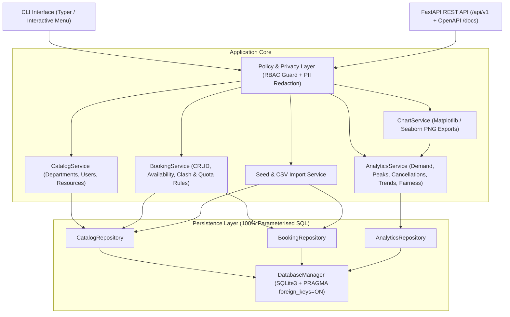
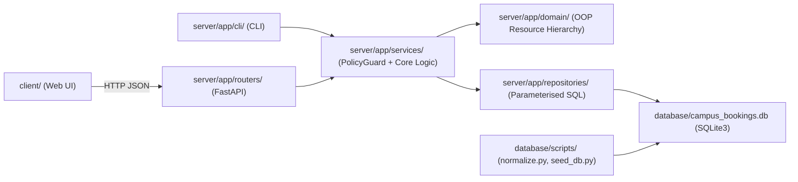

# System Architecture & Design

## 1. Design Philosophy

1. **Admin-First Core, Policy Layer on Top**: Build the full domain and data capabilities first from an unrestricted `admin` perspective (full CRUD across entities, conflict checks, CSV import/seed, analytics, charts), while passing an explicit `ActorContext` (`user_id`, `role`) through every service boundary from day one. Role-based authorisation (RBAC) and privacy projections then sit cleanly as a dedicated policy layer without duplicating or blocking core logic.
2. **Single Core, Dual Thin Interfaces**: Both the **FastAPI REST API** and the **CLI** call the exact same service layer and Pydantic schemas so business rules (validation, conflict checks, RBAC, analytics) are guaranteed identical everywhere.
3. **Configurable Business Policies**: Uncertain institutional rules (e.g. daily/weekly booking quota per student, max advance booking horizon, cancellation cutoff, manual approval for specialist equipment) are isolated in a `BookingPolicyConfig` object so outcomes from the mock stakeholder interview can be applied without refactoring core code.
4. **Strict Separation of Concerns & TDD**: Each layer has a single responsibility and is unit/integration-tested with `pytest` against isolated SQLite databases.

---

## 2. High-Level Architecture

*Rendered exports: `docs/design/diagrams/layered_architecture.{mmd,png}`.*



---

## 3. Project Structure & Module Boundaries

The repository uses a clean 3-pillar monorepo layout (`database/` + `server/` + `client/`) alongside academic and engineering documentation (`docs/`).

```text
assessments/A1/
├── README.md                              # Setup and run instructions (CLI, FastAPI, client, pytest)
├── PLAN.md                                # Detailed phase-by-phase technical implementation plan
├── TODO.md                                # Actionable checkbox task board (translated from PLAN.md)
├── .gitignore
│
├── docs/                                  # Assessment brief, design specs, and LO5 reflections
│   ├── assessment/                        # brief.md, scenario.md, rubric.md
│   ├── design/                            # 00_research.md .. 06_tdd_plan.md, diagrams/
│   └── SDLC.md                            # SDLC evaluation, stakeholder interview guide/log, TDD evidence, reflection
│
├── database/                              # Data sources, ETL pipeline, canonical DDL & SQLite runtime DB
│   ├── raw/                               # 6 Warwick portal snapshots + 11 slide screenshots
│   ├── scripts/
│   │   ├── normalize.py                   # raw/*.json -> catalog.json (11-table 3NF CTI)
│   │   └── seed_db.py                     # Load catalog.json + synthetic users & multi-week bookings into SQLite
│   ├── apis.json                          # Discovered Warwick source API inventory
│   ├── sitemap.json                       # Portal inventory & observed real-world permission rules
│   ├── schema.sql                         # Canonical 11-table 3NF CTI SQLite DDL (Single Source of Truth)
│   ├── catalog.json                       # Normalized Warwick catalogue (531 resources, 205 buildings, 58 depts)
│   ├── samples/                           # Sample CSV files for batch import & error-reporting demos
│   └── campus_bookings.db                 # Runtime SQLite database (gitignored; reproducible via seed_db.py)
│
├── server/                                # Python 3 Backend: OOP Domain + REST API + CLI + Analytics + TDD
│   ├── pyproject.toml                     # pytest and project metadata
│   ├── requirements.txt
│   ├── app/
│   │   ├── main.py                        # FastAPI entrypoint (uvicorn), router registration, HTTP error mappers
│   │   ├── config.py                      # DB path & BookingPolicyConfig (quotas, horizon, k-anonymity)
│   │   ├── database.py                    # DatabaseManager (sqlite3, PRAGMA foreign_keys=ON, transactions)
│   │   ├── dependencies.py                # FastAPI Depends wiring (DB, services, X-Role / X-User-Id ActorContext)
│   │   ├── domain/                        # Pure OOP domain layer (zero SQL/HTTP coupling)
│   │   │   ├── enums.py                   # Role, UserType, ResourceType, RoomStyle, BookingEligibility, BookingStatusId
│   │   │   ├── exceptions.py              # DomainError, UnauthorizedError, ForbiddenError, NotFoundError, ConflictError, ValidationError
│   │   │   └── resources.py               # Resource(ABC) -> Room/Equipment/Support subclasses + ResourceFactory
│   │   ├── schemas/                       # Shared Pydantic v2 DTOs (used identically by FastAPI & CLI)
│   │   │   ├── actor.py                   # ActorContext & auth header DTOs
│   │   │   ├── reference.py               # Department, Building, Facility, BookingStatus DTOs
│   │   │   ├── user.py                    # UserCreate, UserUpdate, UserOut
│   │   │   ├── resource.py                # Polymorphic ResourceCreate/Update/Out (CTI details union) & AvailabilitySlot
│   │   │   ├── booking.py                 # BookingCreate/Update/Transition/Out, BookingFilter, ImportSummary
│   │   │   └── analytics.py               # OverviewKPI, DemandItem, HeatmapCell, TrendPoint, FairnessRow
│   │   ├── repositories/                  # 100% parameterised raw SQLite3 queries (SQLi-safe)
│   │   │   ├── reference_repo.py          # CRUD departments, buildings, facilities & booking_statuses lookup
│   │   │   ├── user_repo.py               # CRUD users & soft deactivate (is_active = 0)
│   │   │   ├── resource_repo.py           # Atomic CTI create/update, N:M facilities sync, Policy-to-SQL pushdown, soft retire
│   │   │   ├── booking_repo.py            # CRUD bookings, blocks_slot=1 overlap checks, soft delete (deleted_at)
│   │   │   └── analytics_repo.py          # SQL aggregations (demand, underused, heatmap, weekly trends, fairness)
│   │   ├── services/                      # Business logic & access-control boundary
│   │   │   ├── policy.py                  # PolicyGuard: RBAC, Policy-to-SQL pushdown, SHA-256 PII redaction, k>=5
│   │   │   ├── catalog_service.py         # Catalogue orchestration & role enforcement
│   │   │   ├── booking_service.py         # Booking lifecycle, 2-way clash check, loan limits, CSV import
│   │   │   ├── analytics_service.py       # KPI reports & privacy-filtered fairness analytics
│   │   │   └── chart_service.py           # Matplotlib PNG chart generation (demand, heatmap, trends, fairness)
│   │   ├── routers/                       # Thin FastAPI /api/v1 HTTP adapters
│   │   │   ├── health.py
│   │   │   ├── reference.py               # /departments, /buildings, /facilities, /booking-statuses
│   │   │   ├── users.py                   # /users CRUD + soft deactivate
│   │   │   ├── resources.py               # /resources CRUD + /availability
│   │   │   ├── bookings.py                # /bookings CRUD, /approve, /reject, /cancel, /complete, /no-show, /import-csv
│   │   │   └── analytics.py               # /overview, /demand, /heatmap, /trends, /cancellations, /fairness, /charts
│   │   └── cli/                           # Thin CLI adapter sharing the exact same service layer
│   │       ├── main.py                    # Scriptable subcommands (seed, import-csv, book, analytics, charts, serve)
│   │       ├── menu.py                    # Interactive role-aware menu walkthrough
│   │       └── formatting.py              # Aligned f-string table renderer (headers + separators)
│   ├── reports/charts/                    # Generated PNG visualisations
│   └── tests/                             # pytest TDD suite (mirrors application layers)
│       ├── conftest.py                    # Isolated temporary SQLite DB fixture & seed helpers
│       ├── test_db_and_domain.py          # 11-table DDL, FK integrity, CTI 1:1, OOP polymorphism & ResourceFactory
│       ├── test_catalog_crud.py           # CRUD across catalogue entities, N:M facilities, SQLi resistance
│       ├── test_bookings_and_conflicts.py # 2-way overlap, adjacent boundaries, duration limits, cancel vs delete
│       ├── test_policy_and_privacy.py     # 4 roles, Policy-to-SQL pushdown, PII redaction, k>=5 suppression
│       ├── test_analytics_and_charts.py   # KPIs, underused resources, heatmap, weekly trends, fairness, PNG output
│       └── test_api_and_cli.py            # FastAPI TestClient end-to-end & CLI smoke tests
│
└── client/                                # Web UI (Next.js App Router + TypeScript + Tailwind, consumes /api/v1)
    ├── package.json
    ├── tsconfig.json
    ├── next.config.ts
    ├── .env.local.example                 # NEXT_PUBLIC_API_BASE_URL=http://localhost:8000/api/v1
    └── src/
        ├── app/                           # App Router pages
        │   ├── layout.tsx                 # Global shell, sidebar navigation, demo Actor/Role switcher
        │   ├── page.tsx                   # Unified Resource Explorer (5-type tabs, filters, live availability)
        │   ├── resources/[id]/page.tsx    # Resource details, facilities badges, 360° panorama & MazeMap pin
        │   ├── bookings/page.tsx          # My Bookings (upcoming, past, edit purpose, reschedule, cancel)
        │   ├── approvals/page.tsx         # Pending Approval Queue (manager / admin approve & reject with notes)
        │   ├── admin/page.tsx             # Catalogue CRUD (resources, users, departments, buildings, CSV import)
        │   └── analytics/page.tsx         # Utilisation KPIs, 7x24 heatmap, weekly trends & k>=5 fairness dashboard
        ├── components/
        │   ├── layout/                    # Navbar, Sidebar, RoleSwitcher (injects X-Role / X-User-Id headers)
        │   ├── resources/                 # ResourceCard, FilterBar, CampusMap (lat/lon), PanoramaViewer (image_url)
        │   ├── bookings/                  # BookingDrawer (hourly / multi-day loan / workshop), StatusBadge
        │   ├── analytics/                 # KpiGrid, DemandHeatmap, TrendChart, FairnessTable
        │   └── ui/                        # Reusable primitives (Button, Modal, DataTable, Badge, EmptyState)
        ├── lib/
        │   ├── api-client.ts              # Typed fetch wrapper injecting actor headers & standard error handling
        │   ├── resources.api.ts           # /resources, /availability, /facilities API wrappers
        │   ├── bookings.api.ts            # /bookings, /approve, /reject, /cancel, /import-csv API wrappers
        │   └── analytics.api.ts           # /analytics/* API wrappers
        ├── hooks/                         # useActor, useAvailability, useBookings
        └── types/                         # TypeScript interfaces mirroring server/app/schemas/*
```

### One-Way Dependency Flow & Boundary Rules

*Rendered exports: `docs/design/diagrams/dependency_flow.{mmd,png}`.*



- **`database/` owns data provenance & DDL**: `database/schema.sql` is the canonical DDL loaded by `server/app/database.py`, avoiding duplicated SQL definitions.
- **`server/app/domain/` stays framework-free**: No FastAPI or `sqlite3` imports inside `domain/`; pure Python OOP classes and domain rules.
- **`server/app/repositories/` owns all SQL**: 100% parameterised placeholders (`?`); no raw SQL strings in services, routers, or CLI.
- **`server/app/services/policy.py` is the single access-control source of truth**: Enforces both read-side SQL pushdown (`booking_eligibility IN (...)` for FE/CLI) and write-side authorisation (`403 Forbidden` against direct API bypasses).
- **`routers/` and `cli/` are thin adapters**: Zero duplicated business logic; both delegate directly to `services/` and share `schemas/`.
- **`client/` is fully decoupled**: Communicates strictly over `/api/v1`, keeping Python and Node/TypeScript toolchains completely separate.

---

## 4. Tech Stack

- **Language**: Python 3.11+
- **Database**: Built-in `sqlite3` with strict parameterised queries (`?`) and foreign-key enforcement
- **Validation & Schemas**: Pydantic v2
- **REST API**: FastAPI + Uvicorn (auto-generated Swagger UI at `/docs` for live inspection/demo)
- **CLI**: Standard Python / Typer interactive menu for fast demo workflows
- **Analytics & Visualisation**: SQL aggregations + `matplotlib` (bar charts, weekly trend lines, day-by-hour demand heatmap)
- **Testing**: `pytest` + FastAPI `TestClient`

---

## 5. REST API Contract (v1)

All API endpoints accept role/actor context via request headers (`X-Role`, optional `X-User-Id` for ownership checks). During initial admin-first development, auth is lightweight header-based context; the policy guard enforces role boundaries uniformly.

### 5.1 System & Data Setup

| Method | Endpoint | Purpose | Primary Roles |
| :--- | :--- | :--- | :--- |
| `GET` | `/health` | Liveness & DB connectivity check | All |
| `POST` | `/api/v1/admin/seed` | Seed deterministic campus dataset | `admin` |
| `POST` | `/api/v1/admin/import-csv` | Batch import bookings with line-level error/clash report | `admin`, `manager` |

### 5.2 Catalogue Management (Departments, Buildings, Users, Resources)

| Method | Endpoint | Purpose | Primary Roles |
| :--- | :--- | :--- | :--- |
| `GET / POST` | `/api/v1/departments` | List or create departments | Read: All / Write: `admin` |
| `PATCH / DELETE` | `/api/v1/departments/{department_id}` | Update or remove department | `admin` |
| `GET / POST` | `/api/v1/buildings` | List (filter by `zone`) or create campus buildings with GPS coordinates | Read: All / Write: `admin` |
| `PATCH / DELETE` | `/api/v1/buildings/{building_id}` | Update or remove building | `admin` |
| `GET / POST` | `/api/v1/users` | List or create users | Read: `admin`, `manager` / Write: `admin` |
| `PATCH / DELETE` | `/api/v1/users/{user_id}` | Update or remove user | `admin` |
| `GET / POST` | `/api/v1/resources` | List (filter by `resource_type`, `department_id`, `zone`, `building_id`, `facility`, `status`) or add resource | Read: All / Write: `admin`, `manager` |
| `PATCH / DELETE` | `/api/v1/resources/{resource_id}` | Update capacity/location/status (e.g. `maintenance`) or remove | `admin`, `manager` |

### 5.3 Bookings & Availability

| Method | Endpoint | Purpose | Primary Roles |
| :--- | :--- | :--- | :--- |
| `GET` | `/api/v1/availability` | Find active resources free for `start_time`..`end_time` (Unix epoch seconds or ISO-8601 UTC; optional type/zone/facility filters) | All |
| `GET` | `/api/v1/bookings` | Search & filter bookings (`user_id`, `resource_id`, `resource_type`, `department_id`, `course`, `status_id`, `from_ts`, `to_ts`) | All *(scoped/redacted by role)* |
| `POST` | `/api/v1/bookings` | Create booking with resource-clash, user-clash, active-status, and quota validation | `admin`, `manager`, `member` |
| `GET` | `/api/v1/bookings/{booking_id}` | Retrieve single booking record | All *(scoped/redacted by role)* |
| `PATCH` | `/api/v1/bookings/{booking_id}` | Reschedule `start_time`/`end_time`, update status, or edit reference/notes (re-runs conflict check) | `admin`, `manager`, owner `member` |
| `POST` | `/api/v1/bookings/{booking_id}/approve` | Approve `pending` request (`pending` -> `confirmed`) | `admin`, `manager` |
| `POST` | `/api/v1/bookings/{booking_id}/reject` | Decline `pending` request (`rejected`, releases slot) | `admin`, `manager` |
| `POST` | `/api/v1/bookings/{booking_id}/cancel` | Cancel booking (`status_id = 'cancelled'`), releasing slot while keeping history | `admin`, `manager`, owner `member` |
| `DELETE` | `/api/v1/bookings/{booking_id}` | Soft-delete record (`deleted_at = now`; zero hard deletes) | `admin` |

### 5.4 Analytics & Visualisations

| Method | Endpoint | Purpose | Stakeholder Focus |
| :--- | :--- | :--- | :--- |
| `GET` | `/api/v1/analytics/overview` | KPI summary (total bookings, active rate, cancellation & no-show rates, active resources) | Both |
| `GET` | `/api/v1/analytics/demand` | Resource ranking (most booked + underused/zero-booking resources) & breakdown by type/department | Learning Resources Manager |
| `GET` | `/api/v1/analytics/heatmap` | Booking counts matrix by day-of-week × hour slot (busiest days & peak hours) | Learning Resources Manager |
| `GET` | `/api/v1/analytics/trends` | Weekly booking volume over time to expose semester pressure periods | Student Services Rep |
| `GET` | `/api/v1/analytics/cancellations` | Cancellation & no-show breakdown by resource type, department, and course | Learning Resources Manager |
| `GET` | `/api/v1/analytics/fairness` | Bookings & hours per course/user with small-cohort suppression (`k >= 5`) | Student Services Rep |
| `POST` | `/api/v1/analytics/charts` | Generate/refresh PNG charts (demand bar chart, peak-time heatmap, weekly trend line, course fairness chart) | `admin`, `manager`, `student_services` |

### 5.5 Standard Error Mapping

- `401 Unauthorized`: Missing or unrecognised role/actor context
- `403 Forbidden`: Role lacks permission or attempting to modify another user's booking
- `404 Not Found`: Unknown department, user, resource, or booking ID
- `409 Conflict`: Resource time overlap, user time overlap, duplicate primary/unique key, or FK restriction
- `422 Unprocessable Entity`: Invalid date/time format, `end_time <= start_time`, quota exceeded, or inactive resource

---

## 6. CLI Interface

The CLI mirrors the same core services for quick scripted runs and the 15-minute live presentation:

- **Interactive menu**: Guided actions for catalogue browsing, availability lookup, booking CRUD/cancel, role switching, analytics summaries, and chart export.
- **Direct subcommands**: Scriptable commands (e.g. `seed`, `import-csv`, `book`, `availability`, `analytics`, `charts`, `serve`) to demonstrate automation and run repeatable checks.

---

## 7. Privacy, Ethics & Security Controls

- **SQL Injection Prevention**: 100% parameterised SQL placeholders (`?`); dynamic filters append only whitelisted column predicates.
- **Privacy by Role**:
  - `student_services` never receives raw student names/emails/IDs or `purpose`/`notes`; IDs are SHA-256 pseudonymised (`ANON-...`) and course cohorts smaller than `k = 5` are suppressed/grouped.
  - `member` can only view and manage their own bookings (never other students' records).
- **Data Minimisation**: Optional `purpose` keeps booking forms minimal (`requires_approval = 0` needs no explanation) and is redacted automatically for read-only analytical roles.

---

## 8. Open Policy Questions for Stakeholder Interviews

Core implementation proceeds immediately with sensible defaults; the following policy knobs can be tuned directly in `BookingPolicyConfig` after interviewing the mock stakeholders:

1. **Fairness Quotas**: Should students have a daily/weekly booking cap (e.g. max 2 bookings/day or 6 hours/week) to prevent slot hoarding during exam weeks?
2. **Booking Horizon & Cancellation Cutoff**: How far in advance may bookings be made (e.g. 14 days), and is there a late-cancellation / no-show threshold?
3. **Approval Workflow**: Do all 5 resource types auto-confirm, or should `specialist_equipment` / `academic_support` default to `pending` pending staff approval?
4. **Maintenance Overrides**: When a resource moves to `maintenance`, should existing future bookings auto-cancel with a flag or require manual manager review?
5. **Privacy Boundary**: Confirm whether `student_services` should only view aggregated/anonymised metrics and whether `purpose` should be optional on auto-confirmed bookings.
