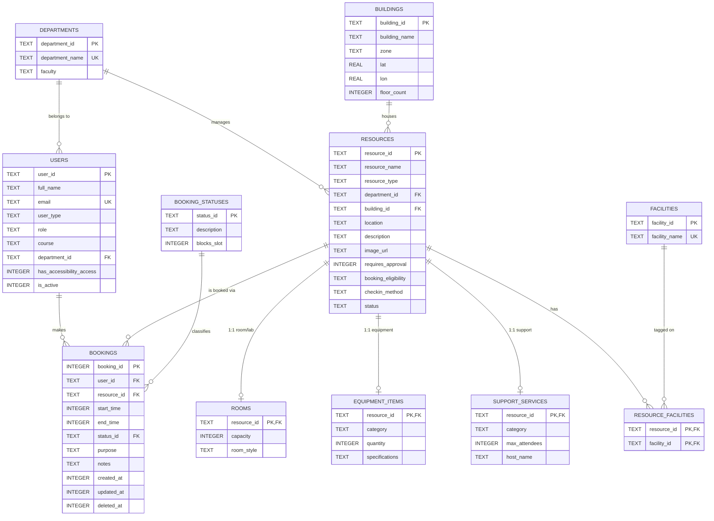

# Domain Model & Database Schema

## 1. Overview & ERD

The **Campus Learning Resources Booking System** models university learning resources from first principles using **4 actors** and **11 strictly normalised (3NF, zero-JSON) tables** in SQLite3 (`PRAGMA foreign_keys = ON`). External university datasets (such as Warwick's portals) are treated purely as seed adapters mapped into this clean domain model—never dictating schema columns.

To balance **OOA/OOD inheritance** with pragmatic flexibility (avoiding brittle over-specialisation), the schema applies **Class Table Inheritance (CTI)** across the **3 genuinely distinct physical/service resource archetypes** plus an open `description` field for real-world edge cases:

- **Core tables (6)**: `departments`, `buildings`, `users`, `resources` *(supertype)*, `booking_statuses`, `bookings`.
- **Resource subtype tables (3, 1:1 with `resources`)**:
  - `rooms` — unifies all physical spaces (`study_room`, `group_space`, `computer_lab`), while OS/AV/accessibility features live flexibly in `facilities`.
  - `equipment_items` — loanable hardware pools and specialist kits (`specialist_equipment`).
  - `support_services` — repeatable 1-on-1 consultations and group workshops (`academic_support`).
- **Many-to-Many facility tables (2)**: `facilities` and `resource_facilities` — extensible atomic tags (AV, Linux/Windows OS, Tutor PC, Height-Adjustable Desk, Whiteboard, etc.).

### Actors

| Actor (`role`) | Primary Scope | Access & Privacy Model |
| :--- | :--- | :--- |
| `admin` | Full system management (departments, buildings, users, resources, bookings, overrides, analytics) | Unconstrained god-view; core system is built against this role first |
| `manager` *(Learning Resources Manager)* | Manage resource catalogue, approve/reject `pending` bookings, manage cancellations, view operational analytics | Full resource/booking operations; operational reporting |
| `student_services` *(Student Services Rep)* | Read-only access to availability, course fairness, and semester pressure trends | Pseudonymised student IDs (SHA-256), redacted `purpose`/`notes`, small-cohort suppression (`k >= 5`) |
| `member` *(Student / Staff)* | Browse eligible available resources, create bookings for self, reschedule or cancel own bookings | Ownership-scoped; eligibility enforced via Policy-to-SQL pushdown on `user_type` + `has_accessibility_access` |

### Entity-Relationship Diagram (ERD)

*Rendered vector/raster exports live in `docs/design/diagrams/` (`erd.mmd`, `erd.svg`, `erd.png`).*

---

## 2. Entity Schemas

### 2.1 `departments`

Organisational units owning resources and users (separate from physical buildings since one unit like Library or Central Timetabling spans multiple buildings).

| Column | Type | Constraints | Description |
| :--- | :--- | :--- | :--- |
| `department_id` | `TEXT` | `PRIMARY KEY` | Short stable identifier (e.g. `WMG`, `CS`, `LIB`, `IDG`, `CENTRAL`) |
| `department_name` | `TEXT` | `NOT NULL UNIQUE` | Full department or service unit name |
| `faculty` | `TEXT` | `NOT NULL` | Parent faculty or service division (e.g. `Sci., Eng. and Med.`, `Arts`, `Social Sciences`, `Services`) |

### 2.2 `buildings`

Physical campus buildings, decoupled from `departments` for strict 3NF, zone filtering, and interactive map coordinates.

| Column | Type | Constraints | Description |
| :--- | :--- | :--- | :--- |
| `building_id` | `TEXT` | `PRIMARY KEY` | Stable building identifier (e.g. `MM-1016749`, `LIB-MAIN`) |
| `building_name` | `TEXT` | `NOT NULL` | Building display name (e.g. `Rootes`, `Faculty of Arts`, `Library`) |
| `zone` | `TEXT` | `NOT NULL CHECK (zone IN ('Main Site', 'Gibbet Hill Site', 'Westwood Site', 'Innovation Campus'))` | Campus site zone |
| `lat` | `REAL` | `NULL` | WGS84 latitude |
| `lon` | `REAL` | `NULL` | WGS84 longitude |
| `floor_count` | `INTEGER` | `NOT NULL DEFAULT 1 CHECK (floor_count >= 0)` | Number of mapped building floors |

### 2.3 `users`

Students, staff, and operators. Separates academic affiliation (`user_type`) from system permissions (`role`), and supports soft deactivation (`is_active`).

| Column | Type | Constraints | Description |
| :--- | :--- | :--- | :--- |
| `user_id` | `TEXT` | `PRIMARY KEY` | University identifier (e.g. `S1001`, `STF01`) |
| `full_name` | `TEXT` | `NOT NULL` | Display name |
| `email` | `TEXT` | `NOT NULL UNIQUE` | Institutional email |
| `user_type` | `TEXT` | `NOT NULL CHECK (user_type IN ('ug_student', 'pg_student', 'pgr_student', 'staff'))` | Academic affiliation used for booking eligibility and quotas |
| `role` | `TEXT` | `NOT NULL CHECK (role IN ('admin', 'manager', 'student_services', 'member'))` | System RBAC role |
| `course` | `TEXT` | `NULL` | Degree programme for students (nullable for staff); used in course-fairness analytics |
| `department_id` | `TEXT` | `NOT NULL REFERENCES departments(department_id) ON DELETE RESTRICT` | Home department |
| `has_accessibility_access` | `INTEGER` | `NOT NULL DEFAULT 0 CHECK (has_accessibility_access IN (0, 1))` | Data-minimised eligibility flag for accessible study rooms (stores no medical details) |
| `is_active` | `INTEGER` | `NOT NULL DEFAULT 1 CHECK (is_active IN (0, 1))` | Soft-deactivation flag (`0` prevents new logins/bookings while preserving history) |

### 2.4 `resources` *(CTI Supertype)*

Parent table holding attributes shared across all 5 scenario resource categories so `bookings` keeps a single foreign key (`resource_id`) and cross-campus analytics run cleanly without `UNION` queries. Maps to Python's abstract base class `Resource(ABC)`.

| Column | Type | Constraints | Description |
| :--- | :--- | :--- | :--- |
| `resource_id` | `TEXT` | `PRIMARY KEY` | Unique resource identifier |
| `resource_name` | `TEXT` | `NOT NULL` | Human-readable name |
| `resource_type` | `TEXT` | `NOT NULL CHECK (resource_type IN ('study_room', 'group_space', 'computer_lab', 'specialist_equipment', 'academic_support'))` | Scenario category (`study_room`/`group_space`/`computer_lab` -> `rooms`; `specialist_equipment` -> `equipment_items`; `academic_support` -> `support_services`) |
| `department_id` | `TEXT` | `NOT NULL REFERENCES departments(department_id) ON DELETE RESTRICT` | Managing department or service |
| `building_id` | `TEXT` | `NULL REFERENCES buildings(building_id) ON DELETE RESTRICT` | Physical building (`NULL` for online-only support services) |
| `location` | `TEXT` | `NOT NULL` | Short pinpoint location: room number (`FAB0.03`, `A0.01`), pickup point (`Floor 1 Lobby Lockers`), or `Online (MS Teams)` |
| `description` | `TEXT` | `NULL` | Flexible free-text notes (opening hours, sensory/access instructions, loan rules, software, edge cases) |
| `image_url` | `TEXT` | `NULL` | Optional room photo or 360° panorama URL (e.g. `.../roominformation/fab507/fab507.jpg`) |
| `requires_approval` | `INTEGER` | `NOT NULL DEFAULT 0 CHECK (requires_approval IN (0, 1))` | `1` starts member bookings in `pending`; `0` auto-confirms |
| `booking_eligibility` | `TEXT` | `NOT NULL DEFAULT 'all_users' CHECK (booking_eligibility IN ('all_users', 'students_only', 'staff_only', 'pg_only', 'pgr_and_staff', 'disability_only'))` | User eligibility policy evaluated against `users.user_type` and `has_accessibility_access` |
| `checkin_method` | `TEXT` | `NOT NULL DEFAULT 'none' CHECK (checkin_method IN ('none', 'pin', 'card_swipe'))` | Physical check-in / collection method (`none`, `pin` keypad, or `card_swipe` reader) |
| `status` | `TEXT` | `NOT NULL DEFAULT 'active' CHECK (status IN ('active', 'maintenance', 'retired'))` | Lifecycle status (`retired` is soft delete; only `active` accepts new bookings) |

#### 2.4.1 `rooms` *(CTI Subtype — `study_room`, `group_space`, `computer_lab`)*

Unified physical-space subtype covering study rooms, group spaces, teaching/meeting rooms, and computer labs. Room equipment, OS environments (Linux/Windows), and accessibility features are attached flexibly via `facilities` + `description`. Maps to `RoomResource`.

| Column | Type | Constraints | Description |
| :--- | :--- | :--- | :--- |
| `resource_id` | `TEXT` | `PRIMARY KEY REFERENCES resources(resource_id) ON DELETE CASCADE` | Shared PK/FK to parent `resources` |
| `capacity` | `INTEGER` | `NOT NULL CHECK (capacity > 0)` | Max seats or workstations inside the room (room itself is reserved exclusively: 1 active booking per slot) |
| `room_style` | `TEXT` | `NOT NULL DEFAULT 'standard' CHECK (room_style IN ('seminar', 'lecture', 'boardroom', 'study_pod', 'flexible', 'standard'))` | Physical room furniture/layout style |

#### 2.4.2 `equipment_items` *(CTI Subtype — `specialist_equipment`)*

Generalised subtype for any borrowable campus equipment—single items, multi-piece kits, or self-service locker pools—avoiding brittle hardware-specific columns. Maps to `EquipmentResource`.

| Column | Type | Constraints | Description |
| :--- | :--- | :--- | :--- |
| `resource_id` | `TEXT` | `PRIMARY KEY REFERENCES resources(resource_id) ON DELETE CASCADE` | Shared PK/FK to parent `resources` |
| `category` | `TEXT` | `NOT NULL` | Open equipment category label (e.g. `laptop`, `av_kit`, `vr_xr`, `compute`, `lab_hardware`, `instrument`) so new hardware classes need no schema migration |
| `quantity` | `INTEGER` | `NOT NULL DEFAULT 1 CHECK (quantity > 0)` | Available unit count supporting up to `quantity` concurrent loans during overlapping windows |
| `specifications` | `TEXT` | `NULL` | Flexible equipment details (make/model, included accessories, installed software, handling or return notes) |

#### 2.4.3 `support_services` *(CTI Subtype — `academic_support`)*

Repeatable 1-on-1 consultations (`max_attendees = 1`) and group academic/skills support workshops (`max_attendees > 1`). Online vs in-person delivery is expressed naturally via `resources.building_id` and `resources.location`. Maps to `AcademicSupportResource`.

| Column | Type | Constraints | Description |
| :--- | :--- | :--- | :--- |
| `resource_id` | `TEXT` | `PRIMARY KEY REFERENCES resources(resource_id) ON DELETE CASCADE` | Shared PK/FK to parent `resources` |
| `category` | `TEXT` | `NOT NULL` | Open support domain label (e.g. `writing`, `maths_stats`, `careers`, `study_skills`, `disability_advice`, `visa_advice`) |
| `max_attendees` | `INTEGER` | `NOT NULL DEFAULT 1 CHECK (max_attendees > 0)` | Concurrent attendee limit (`1` = 1-on-1 consultation; `> 1` = group workshop) |
| `host_name` | `TEXT` | `NULL` | Advisor or team hosting the service (e.g. `Careers Advisory Team`, `Dr. Sarah Chen`) |

### 2.5 `facilities` & `resource_facilities` *(N:M Lookup)*

Normalises extensible multi-valued features (AV equipment, Linux/Windows OS, Tutor PC, Height-Adjustable Desk, Whiteboard, etc.) into atomic rows for indexed SQL filtering without bloating room/lab tables.

| Table | Column | Type | Constraints | Description |
| :--- | :--- | :--- | :--- | :--- |
| `facilities` | `facility_id` | `TEXT` | `PRIMARY KEY` | Canonical slug (e.g. `LECTURE-CAPTURE`, `LINUX-WORKSTATIONS`, `WHITEBOARD`) |
| `facilities` | `facility_name` | `TEXT` | `NOT NULL UNIQUE` | Human-readable label |
| `resource_facilities` | `resource_id` | `TEXT` | `NOT NULL REFERENCES resources(resource_id) ON DELETE CASCADE` | Composite PK part 1 |
| `resource_facilities` | `facility_id` | `TEXT` | `NOT NULL REFERENCES facilities(facility_id) ON DELETE CASCADE` | Composite PK part 2 |

### 2.6 `booking_statuses`

Controlled lifecycle lookup table distinguishing user cancellations (`cancelled`) from staff refusals (`rejected`).

| Column | Type | Constraints | Description |
| :--- | :--- | :--- | :--- |
| `status_id` | `TEXT` | `PRIMARY KEY CHECK (status_id IN ('pending', 'confirmed', 'cancelled', 'rejected', 'completed', 'no_show'))` | Lifecycle state |
| `description` | `TEXT` | `NOT NULL` | Human-readable meaning |
| `blocks_slot` | `INTEGER` | `NOT NULL CHECK (blocks_slot IN (0, 1))` | `1` for `pending` / `confirmed` (occupies slot); `0` for `cancelled` / `rejected` / `completed` / `no_show` |

### 2.7 `bookings`

Central transactional table storing reservations in UTC Unix epoch seconds with soft delete (`deleted_at`) for full auditability.

| Column | Type | Constraints | Description |
| :--- | :--- | :--- | :--- |
| `booking_id` | `INTEGER` | `PRIMARY KEY AUTOINCREMENT` | Surrogate booking identifier |
| `user_id` | `TEXT` | `NOT NULL REFERENCES users(user_id) ON DELETE RESTRICT` | User who made the reservation |
| `resource_id` | `TEXT` | `NOT NULL REFERENCES resources(resource_id) ON DELETE RESTRICT` | Reserved resource |
| `start_time` | `INTEGER` | `NOT NULL` | Reservation start in Unix epoch seconds (UTC) |
| `end_time` | `INTEGER` | `NOT NULL CHECK (end_time > start_time)` | Reservation end in Unix epoch seconds (UTC), strictly after `start_time` |
| `status_id` | `TEXT` | `NOT NULL REFERENCES booking_statuses(status_id) ON DELETE RESTRICT` | Current lifecycle state |
| `purpose` | `TEXT` | `NULL` | Optional booking purpose/notes (recommended or required when `requires_approval = 1`; visible to owner/`admin`/`manager`, redacted for `student_services`) |
| `notes` | `TEXT` | `NULL` | Optional flexible remarks (extra user requests, manager rejection reason, equipment handover/return notes; redacted for `student_services`) |
| `created_at` | `INTEGER` | `NOT NULL DEFAULT (CAST(strftime('%s', 'now') AS INTEGER))` | UTC creation Unix timestamp |
| `updated_at` | `INTEGER` | `NOT NULL DEFAULT (CAST(strftime('%s', 'now') AS INTEGER))` | UTC last-modified Unix timestamp |
| `deleted_at` | `INTEGER` | `NULL` | Soft-delete Unix timestamp (`NULL` = active record; non-null rows excluded from normal queries and conflict checks) |

### 2.8 Indexes, Integrity & Domain Invariants

- **Indexes**:
  - `idx_bookings_resource_window ON bookings(resource_id, start_time, end_time, status_id) WHERE deleted_at IS NULL` — accelerates conflict detection and availability checks.
  - `idx_bookings_user_window ON bookings(user_id, start_time, end_time, status_id) WHERE deleted_at IS NULL` — accelerates user double-booking checks and quota checks.
  - `idx_bookings_start_time ON bookings(start_time) WHERE deleted_at IS NULL` — accelerates weekly trend and peak-time analytics.
  - `idx_resources_type_dept ON resources(resource_type, department_id, status)` — accelerates catalogue browsing.
  - `idx_resource_facilities_fac ON resource_facilities(facility_id, resource_id)` — accelerates facility-tag filtering.
- **Conflict & Capacity Rules** *(executed inside `BEGIN IMMEDIATE` SQLite transactions to prevent race conditions)*:
  - *Polymorphic concurrency limit (`Resource.max_concurrent_bookings()`)*: Reject if `COUNT(non-deleted overlapping blocking bookings) >= limit`, where `limit = 1` for `RoomResource`, `limit = quantity` for `EquipmentResource`, and `limit = max_attendees` for `AcademicSupportResource` (adjacent back-to-back slots where `existing.end_time == new.start_time` are permitted).
  - *User clash*: Reject if the same `user_id` already holds any overlapping blocking booking.
  - *Configurable duration ceiling*: Enforced polymorphically via `BookingPolicyConfig` (e.g. default max 4h for rooms/labs, 7 days for equipment loans, 2h for academic support—tunable after stakeholder interviews without schema changes).
  - *Lifecycle state*: Reject new bookings if `resource.status != 'active'` or `user.is_active != 1`.
- **Soft Delete Policy (No Hard Delete)**:
  - Normal cancellation transitions `bookings.status_id = 'cancelled'` (preserving cancellation-rate analytics).
  - Admin `DELETE /api/v1/bookings/{id}` sets `deleted_at = now` (soft delete), preserving audit history.
  - Admin `DELETE /api/v1/resources/{id}` transitions `status = 'retired'`; `DELETE /api/v1/users/{id}` sets `is_active = 0`.
