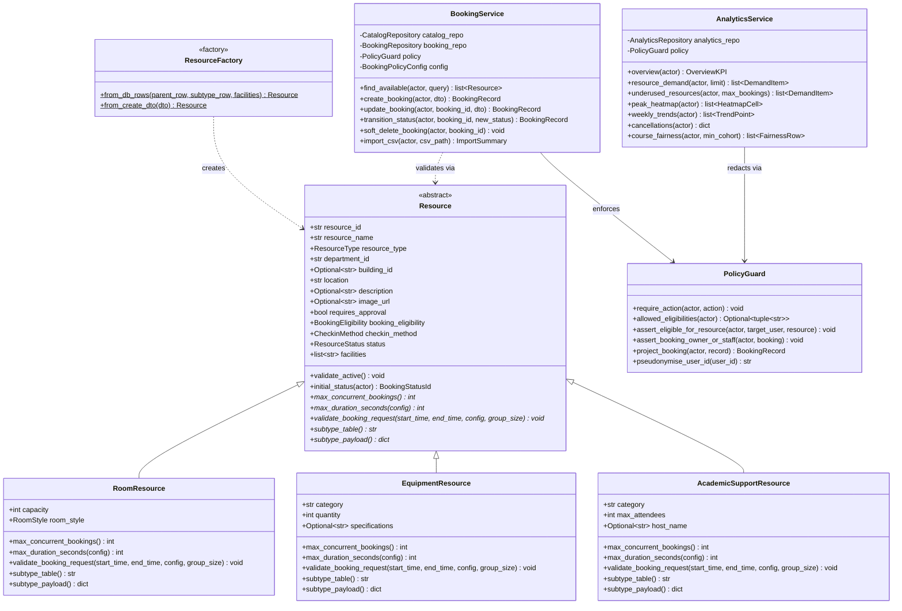

# Object-Oriented Analysis & Design (OOA/OOD)

This document defines the Python OOP domain model (`server/app/domain/`), design patterns, and service contracts before writing code. It bridges Week 2 OOP & Design Patterns (Abstraction, Inheritance, Polymorphism, Factory Pattern, Strategy/Policy separation) directly onto the 11-table CTI database schema.

---

## 1. Class Diagram

*Rendered exports: `docs/design/diagrams/class_diagram.{mmd,svg,png}`.*

---

## 2. Domain Hierarchy (`server/app/domain/resources.py`)

All domain classes live in `server/app/domain/` with **zero imports from FastAPI or `sqlite3`** so business invariants can be unit-tested in milliseconds.

### 2.1 Abstract Base Class: `Resource(ABC)`

- **Shared State**: Holds every column from the `resources` supertype table plus its resolved `facilities: list[str]`. Uses `description: str | None` as the single flexible notes field inherited by all subclasses.
- **Shared Concrete Behaviours**:
  - `validate_active()`: Raises `ValidationError` if `status != ResourceStatus.ACTIVE`.
  - `initial_status(actor)`: Returns `BookingStatusId.PENDING` when `requires_approval` is `True` and `actor.role == Role.MEMBER`; otherwise `BookingStatusId.CONFIRMED`.
- **Abstract Polymorphic Hooks**:
  - `max_concurrent_bookings() -> int`: Cleanly separates room seat capacity (`1` exclusive booking) from pooled equipment `quantity` and workshop `max_attendees`.
  - `max_duration_seconds(config) -> int`: Reads subtype-appropriate ceiling from `BookingPolicyConfig` (e.g. 4h rooms, 7d equipment, 2h support).
  - `validate_booking_request(start_time, end_time, config, group_size=None)`: Subclass-specific validation.
  - `subtype_table() -> str` & `subtype_payload() -> dict`: Clean CTI persistence mapping without `if/elif` chains scattered across repositories.

### 2.2 Concrete Subclasses (3 CTI Archetypes)

| Subclass | `resource_type` Values | CTI Table | Polymorphic Rule Overrides |
| :--- | :--- | :--- | :--- |
| **`RoomResource`** | `study_room`, `group_space`, `computer_lab` | `rooms` | `max_concurrent_bookings() -> 1`; enforces `1 <= group_size <= capacity` (when provided) and `config.max_room_hours`. |
| **`EquipmentResource`** | `specialist_equipment` | `equipment_items` | `max_concurrent_bookings() -> self.quantity`; enforces `config.max_equipment_loan_days`. |
| **`AcademicSupportResource`** | `academic_support` | `support_services` | `max_concurrent_bookings() -> self.max_attendees` (`1` for 1-on-1, `>1` for group workshops); enforces `config.max_support_hours`. |

### 2.3 Factory Pattern: `ResourceFactory`

- `ResourceFactory.from_db_rows(parent_row, subtype_row, facilities) -> Resource`: Instantiates the exact concrete subclass from `parent_row['resource_type']`.
- `ResourceFactory.from_create_dto(dto) -> Resource`: Instantiates and validates a domain object from incoming Pydantic DTOs before repository persistence.
- **Benefit (Open/Closed Principle)**: Adding a future resource archetype (e.g. `LabBenchResource`) requires registering one new subclass in `ResourceFactory` without modifying `BookingService`, routers, or CLI.

---

## 3. Typed Domain Exceptions (`server/app/domain/exceptions.py`)

| Exception | Meaning | HTTP Status (FastAPI) |
| :--- | :--- | :--- |
| `DomainError` | Base class for all application errors | `400` |
| `AuthenticationError` | Missing or unknown `X-Role` / `X-User-Id` actor context | `401 Unauthorized` |
| `AuthorizationError` | Role lacks permission, ineligible for resource, or non-owner access | `403 Forbidden` |
| `NotFoundError` | Entity does not exist (or soft-deleted) | `404 Not Found` |
| `ConflictError` | Resource clash, pooled capacity full, user double-booking, or unique key violation | `409 Conflict` |
| `ValidationError` | Invalid time window, exceeds policy max duration, inactive resource/user, or invalid status transition | `422 Unprocessable Content` |

---

## 4. Access Control & Privacy (`server/app/services/policy.py`)

`PolicyGuard` is the **single source of truth** for both RBAC and resource eligibility:

1. **Action RBAC (`require_action`)**: Explicit permission matrix per role (`admin`, `manager`, `student_services`, `member`). Core development begins with `admin` having wildcard access, while every service method accepts `actor: ActorContext` from day one.
2. **Policy-to-SQL Pushdown (`allowed_eligibilities`)**:
   - Returns `None` (no restriction) for `admin`, `manager`, `student_services`.
   - For `member`, computes the exact tuple of permitted `booking_eligibility` values from `actor.user_type` + `actor.has_accessibility_access`.
   - Passed directly into `CatalogRepository.list_resources(...)` and `BookingRepository.find_available(...)` as a parameterised `IN (?, ?, ...)` SQL clause so the frontend only receives resources the active user can book.
3. **Write-Side Enforcement (`assert_eligible_for_resource`)**: Re-evaluates the exact same rule on `POST /api/v1/bookings` so direct API calls cannot bypass UI filtering.
4. **Privacy Projection (`project_booking`)**: For `student_services`, hashes `user_id` via salted SHA-256 (`ANON-<10hex>`), strips `user_name`/`email`, and replaces `purpose` and `notes` with `"[REDACTED]"`. In `AnalyticsService.course_fairness()`, cohorts with `< min_cohort` (default `5`) unique users are merged into `"Other (<5)"`.

---

## 5. Booking Lifecycle & Repository Contracts

- **State Transition Validator**: Enforced in `BookingService.transition_status()` via an explicit transition map `ALLOWED_TRANSITIONS: dict[BookingStatusId, set[BookingStatusId]]` matching `docs/design/01_requirements.md`.
- **Transaction Boundary**: `DatabaseManager.transaction(immediate=True)` wraps multi-table CTI writes (`CatalogRepository`) and conflict-checked booking writes (`BookingRepository`) inside SQLite `BEGIN IMMEDIATE ... COMMIT / ROLLBACK`.
- **Strict Repository Separation**: Only `server/app/repositories/` executes SQL; all predicates use `?` placeholders, all `ORDER BY` clauses map through static allowlists, and every normal query filters `deleted_at IS NULL`.
