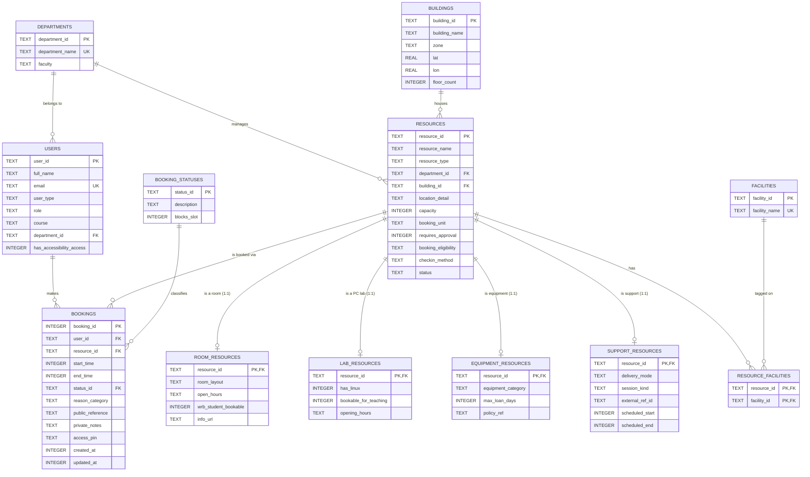

# Domain Model & Database Schema

## 1. Overview & ERD

The **Campus Learning Resources Booking System** centralises reservations across University of Warwick campuses using **4 actors** and **12 strictly normalised (3NF, zero-JSON) tables** in SQLite3 (`PRAGMA foreign_keys = ON`), grounded in Warwick's real multi-portal data (Central Timetabling WRB, Library Spaces & RoomBooking, IDG Work Areas, Laptop Loans, myAdvantage, and MazeMap).

To bridge **OOA/OOD inheritance** with relational database design cleanly, the schema applies **Class Table Inheritance (CTI / Supertype–Subtype)**:

- **Core tables (6)**: `departments`, `buildings`, `users`, `resources` *(supertype)*, `booking_statuses`, `bookings`.
- **Resource subtype tables (4, 1:1 with `resources`)**: `room_resources`, `lab_resources`, `equipment_resources`, `support_resources` — mirroring Python's abstract base class `Resource(ABC)` and its concrete subclasses.
- **Many-to-Many facility tables (2)**: `facilities` and `resource_facilities` — storing Warwick's AV/equipment tags atomically with zero JSON columns.

### Actors

| Actor (`role`) | Primary Scope | Access & Privacy Model |
| :--- | :--- | :--- |
| `admin` | Full system management (departments, users, resources, bookings, seed/import, overrides, analytics) | Unconstrained god-view; core system is built against this role first |
| `manager` *(Learning Resources Manager)* | Manage resource catalogue, create/update/approve/cancel bookings, view operational analytics | Full resource/booking operations; operational reporting |
| `student_services` *(Student Services Rep)* | Read-only access to availability, fairness across courses, and semester pressure trends | Pseudonymised student IDs, redacted free-text notes, small-cohort aggregation (`k >= 5`) |
| `member` *(Student / Staff)* | Browse available spaces, create bookings for self, reschedule or cancel own bookings | Ownership-scoped; `student` vs `staff` distinguished via `user_type` for quota rules |

### Core Entities

- **`departments`**: Academic and service units owning resources and users (organisational hierarchy; separate from physical buildings).
- **`buildings`**: Physical campus buildings with zone, WGS84 coordinates, and atomic `floor_count` (sourced from Warwick MazeMap).
- **`users`**: Students and staff who book or administer resources.
- **`resources` (Supertype) + 4 Subtype Tables**: Unified parent table for shared attributes and single-FK booking integrity, extended 1:1 by `room_resources`, `lab_resources`, `equipment_resources`, and `support_resources`.
- **`facilities` & `resource_facilities`**: Normalised N:M catalogue of AV and room equipment tags (e.g. `Lecture Capture`, `Teams Enhanced AV`, `Whiteboard`).
- **`booking_statuses`**: Controlled lifecycle states with a `blocks_slot` flag for conflict detection.
- **`bookings`**: Central reservation records linking users, resources, time windows, statuses, public/private reason split, and optional door access PIN.

### Entity-Relationship Diagram (ERD)

---

## 2. Entity Schemas

### 2.1 `departments`

Stores university academic departments and central service units (organisational ownership, independent of physical buildings since one unit like Central Timetabling or Library spans multiple buildings).

| Column | Type | Constraints | Description |
| :--- | :--- | :--- | :--- |
| `department_id` | `TEXT` | `PRIMARY KEY` | Short stable identifier (e.g. `WMG`, `CS`, `LIB`, `IDG`, `CENTRAL`) |
| `department_name` | `TEXT` | `NOT NULL UNIQUE` | Official department or service name (from Warwick's 52-department directory) |
| `faculty` | `TEXT` | `NOT NULL` | Parent faculty/group (e.g. `Sci., Eng. and Med.`, `Arts`, `Social Sciences`, `Services`, `Cross faculty`) |

### 2.2 `buildings`

Stores physical campus buildings separately from `departments` to preserve 3NF and support campus-zone filtering and interactive map coordinates (sourced from Warwick MazeMap).

| Column | Type | Constraints | Description |
| :--- | :--- | :--- | :--- |
| `building_id` | `TEXT` | `PRIMARY KEY` | Stable building identifier (e.g. MazeMap ID `MM-1016749` or short code `ROOTES`, `FAB`, `ZEEMAN`) |
| `building_name` | `TEXT` | `NOT NULL` | Building name (e.g. `Rootes`, `Faculty of Arts Building`, `Main Library`) |
| `zone` | `TEXT` | `NOT NULL CHECK (zone IN ('Main Site', 'Gibbet Hill Site', 'Westwood Site', 'Innovation Campus'))` | Campus zone matching WRB sites (`Main Site`, `Gibbet Hill Site`, `Westwood Site`, `Innovation Campus`) |
| `lat` | `REAL` | `NULL` | WGS84 latitude (e.g. `52.378429`) |
| `lon` | `REAL` | `NULL` | WGS84 longitude (e.g. `-1.561232`) |
| `floor_count` | `INTEGER` | `NOT NULL DEFAULT 1 CHECK (floor_count >= 0)` | Number of mapped building floors from MazeMap |

### 2.3 `users`

Stores students, staff, and system operators. Separating `user_type` (academic affiliation) from `role` (system permissions) keeps RBAC clean and extensible.

| Column | Type | Constraints | Description |
| :--- | :--- | :--- | :--- |
| `user_id` | `TEXT` | `PRIMARY KEY` | University ID (e.g. `S1001`, `STF01`) |
| `full_name` | `TEXT` | `NOT NULL` | Display name |
| `email` | `TEXT` | `NOT NULL UNIQUE` | Institutional email |
| `user_type` | `TEXT` | `NOT NULL CHECK (user_type IN ('ug_student', 'pg_student', 'pgr_student', 'staff'))` | Academic affiliation (undergraduate, taught postgraduate, research postgraduate, or staff) used for eligibility and quota rules |
| `role` | `TEXT` | `NOT NULL CHECK (role IN ('admin', 'manager', 'student_services', 'member'))` | Active RBAC role |
| `course` | `TEXT` | `NULL` | Degree programme for students (nullable for non-teaching staff); used in course-fairness analytics |
| `department_id` | `TEXT` | `NOT NULL REFERENCES departments(department_id) ON DELETE RESTRICT` | Owning department |
| `has_accessibility_access` | `INTEGER` | `NOT NULL DEFAULT 0 CHECK (has_accessibility_access IN (0, 1))` | Atomic eligibility flag for Disability Services Accessible Study Rooms (data-minimised: stores no medical details) |

### 2.4 `resources` *(CTI Supertype)*

Parent table holding all shared attributes across the 5 scenario resource categories so `bookings` maintains a single foreign key (`resource_id`) and cross-campus analytics run without `UNION` queries. Maps to Python's abstract base class `Resource(ABC)`.

| Column | Type | Constraints | Description |
| :--- | :--- | :--- | :--- |
| `resource_id` | `TEXT` | `PRIMARY KEY` | Unique resource code (e.g. `CTR-FAB105`, `LIB-GSR-7`, `LAB-A0-01`, `EQ-LIB-LOCKER-LAPTOP`, `SUP-1TO1-45`) |
| `resource_name` | `TEXT` | `NOT NULL` | Human-readable label |
| `resource_type` | `TEXT` | `NOT NULL CHECK (resource_type IN ('study_room', 'computer_lab', 'specialist_equipment', 'academic_support', 'group_space'))` | Discriminator selecting the matching CTI subtype table and Python subclass |
| `department_id` | `TEXT` | `NOT NULL REFERENCES departments(department_id) ON DELETE RESTRICT` | Managing department or central service |
| `building_id` | `TEXT` | `NULL REFERENCES buildings(building_id) ON DELETE RESTRICT` | Physical building (`NULL` for online-only academic support sessions) |
| `location_detail` | `TEXT` | `NOT NULL` | Room number, floor, locker location, or `Online (MS Teams)` |
| `capacity` | `INTEGER` | `NOT NULL CHECK (capacity > 0)` | Max seats, PCs, or concurrent loan units |
| `booking_unit` | `TEXT` | `NOT NULL DEFAULT 'hourly' CHECK (booking_unit IN ('hourly', 'daily'))` | `hourly` for rooms/labs/support slots; `daily` for up-to-7-day equipment loans |
| `requires_approval` | `INTEGER` | `NOT NULL DEFAULT 0 CHECK (requires_approval IN (0, 1))` | `1` starts booking as `pending` (e.g. Central WRB rooms); `0` auto-confirms (e.g. Library Group Study) |
| `booking_eligibility` | `TEXT` | `NOT NULL DEFAULT 'all_users' CHECK (booking_eligibility IN ('all_users', 'students_only', 'staff_only', 'pg_only', 'pgr_and_staff', 'disability_only'))` | Who is permitted to book the resource (evaluated against `user_type` and `has_accessibility_access`) |
| `checkin_method` | `TEXT` | `NOT NULL DEFAULT 'none' CHECK (checkin_method IN ('none', 'pin', 'card_swipe'))` | Physical entry/collection control (`pin` generates 4-digit `access_pin`; `card_swipe` requires door/locker card tap) |
| `status` | `TEXT` | `NOT NULL DEFAULT 'active' CHECK (status IN ('active', 'maintenance', 'retired'))` | Operational availability; only `active` resources accept new bookings |

#### 2.4.1 `room_resources` *(CTI Subtype — `study_room` & `group_space`)*

1:1 extension for bookable study rooms, group-work spaces, central teaching rooms, and meeting rooms. Maps to `RoomResource`.

| Column | Type | Constraints | Description |
| :--- | :--- | :--- | :--- |
| `resource_id` | `TEXT` | `PRIMARY KEY REFERENCES resources(resource_id) ON DELETE CASCADE` | Shared PK/FK to parent `resources` |
| `room_layout` | `TEXT` | `NOT NULL DEFAULT 'flat'` | Layout classification (e.g. `flat, teaching`, `tiered, teaching`, `flat, boardroom`, `flexible`) |
| `open_hours` | `TEXT` | `NULL` | Operating window (e.g. `09:00-22:00`, `08:00-22:00`) |
| `wrb_student_bookable` | `INTEGER` | `NOT NULL DEFAULT 0 CHECK (wrb_student_bookable IN (0, 1))` | `1` if verified visible to students on Warwick WRB 26/27 |
| `info_url` | `TEXT` | `NULL` | Official room info/photo link on `warwick.ac.uk` |

#### 2.4.2 `lab_resources` *(CTI Subtype — `computer_lab`)*

1:1 extension for IDG Open Access PC Work Areas and IT computer labs. Maps to `ComputerLabResource`.

| Column | Type | Constraints | Description |
| :--- | :--- | :--- | :--- |
| `resource_id` | `TEXT` | `PRIMARY KEY REFERENCES resources(resource_id) ON DELETE CASCADE` | Shared PK/FK to parent `resources` |
| `has_linux` | `INTEGER` | `NOT NULL DEFAULT 0 CHECK (has_linux IN (0, 1))` | `1` if Linux workstations are available |
| `bookable_for_teaching` | `INTEGER` | `NOT NULL DEFAULT 0 CHECK (bookable_for_teaching IN (0, 1))` | `1` if staff may reserve the entire lab for teaching |
| `opening_hours` | `TEXT` | `NULL` | Access hours (e.g. `24 hrs`, `07:30 - 21:00`) |

#### 2.4.3 `equipment_resources` *(CTI Subtype — `specialist_equipment`)*

1:1 extension for loanable laptops, AV kits, VR headsets, and lab hardware. Maps to `EquipmentResource`.

| Column | Type | Constraints | Description |
| :--- | :--- | :--- | :--- |
| `resource_id` | `TEXT` | `PRIMARY KEY REFERENCES resources(resource_id) ON DELETE CASCADE` | Shared PK/FK to parent `resources` |
| `equipment_category` | `TEXT` | `NOT NULL` | Category (e.g. `laptop_loan`, `vr_hardware`, `ai_compute`, `av_equipment`, `music_equipment`) |
| `max_loan_days` | `INTEGER` | `NOT NULL DEFAULT 1 CHECK (max_loan_days > 0)` | Maximum loan duration in days (e.g. `7` for Library/IDG laptop loans) |
| `policy_ref` | `TEXT` | `NULL` | Institutional loan policy reference (e.g. `ServiceNow KB0003013`) |

#### 2.4.4 `support_resources` *(CTI Subtype — `academic_support`)*

1:1 extension for 1-on-1 consultations and academic/career workshops from myAdvantage. Maps to `AcademicSupportResource`.

| Column | Type | Constraints | Description |
| :--- | :--- | :--- | :--- |
| `resource_id` | `TEXT` | `PRIMARY KEY REFERENCES resources(resource_id) ON DELETE CASCADE` | Shared PK/FK to parent `resources` |
| `delivery_mode` | `TEXT` | `NOT NULL CHECK (delivery_mode IN ('online', 'in_person', 'hybrid'))` | Delivery format |
| `session_kind` | `TEXT` | `NOT NULL CHECK (session_kind IN ('one_to_one', 'workshop'))` | Individual appointment vs group workshop |
| `external_ref_id` | `TEXT` | `NULL` | Source myAdvantage `topic_id` or `entityId` |
| `scheduled_start` | `INTEGER` | `NULL` | Fixed Unix epoch seconds (UTC) for scheduled workshops (`NULL` for flexible 1-on-1 slots) |
| `scheduled_end` | `INTEGER` | `NULL` | Fixed Unix epoch seconds (UTC) for scheduled workshops |

### 2.5 `facilities` & `resource_facilities` *(N:M Lookup)*

Normalises multi-valued room/equipment features into atomic rows for indexed SQL filtering (`GET /api/v1/resources?facility=Lecture+Capture`).

| Table | Column | Type | Constraints | Description |
| :--- | :--- | :--- | :--- | :--- |
| `facilities` | `facility_id` | `TEXT` | `PRIMARY KEY` | Canonical slug (e.g. `LECTURE-CAPTURE`, `WHITEBOARD`) |
| `facilities` | `facility_name` | `TEXT` | `NOT NULL UNIQUE` | Display label (e.g. `Lecture Capture`, `Whiteboard`) |
| `resource_facilities` | `resource_id` | `TEXT` | `NOT NULL REFERENCES resources(resource_id) ON DELETE CASCADE` | Composite PK part 1 |
| `resource_facilities` | `facility_id` | `TEXT` | `NOT NULL REFERENCES facilities(facility_id) ON DELETE CASCADE` | Composite PK part 2 |

### 2.6 `booking_statuses`

Lookup table defining valid booking states and whether each state occupies a time slot during conflict checks.

| Column | Type | Constraints | Description |
| :--- | :--- | :--- | :--- |
| `status_id` | `TEXT` | `PRIMARY KEY CHECK (status_id IN ('confirmed', 'pending', 'cancelled', 'completed', 'no_show'))` | Lifecycle state |
| `description` | `TEXT` | `NOT NULL` | Human-readable meaning |
| `blocks_slot` | `INTEGER` | `NOT NULL CHECK (blocks_slot IN (0, 1))` | `1` for `confirmed` / `pending` (holds slot); `0` for `cancelled` / `completed` / `no_show` (slot free) |

### 2.7 `bookings`

Central transactional table storing all reservations, preserving status history for analytics, and mirroring Warwick WRB's public-vs-private note split plus Library's door-access PIN.

| Column | Type | Constraints | Description |
| :--- | :--- | :--- | :--- |
| `booking_id` | `INTEGER` | `PRIMARY KEY AUTOINCREMENT` | Surrogate booking identifier |
| `user_id` | `TEXT` | `NOT NULL REFERENCES users(user_id) ON DELETE RESTRICT` | User who made the reservation |
| `resource_id` | `TEXT` | `NOT NULL REFERENCES resources(resource_id) ON DELETE RESTRICT` | Booked resource |
| `start_time` | `INTEGER` | `NOT NULL` | Reservation start in Unix epoch seconds (UTC) — unifies hourly room slots and multi-day equipment loans |
| `end_time` | `INTEGER` | `NOT NULL CHECK (end_time > start_time)` | Reservation end in Unix epoch seconds (UTC), strictly after `start_time` |
| `status_id` | `TEXT` | `NOT NULL REFERENCES booking_statuses(status_id) ON DELETE RESTRICT` | Current booking state |
| `reason_category` | `TEXT` | `NOT NULL CHECK (reason_category IN ('individual_study', 'group_work', 'lab_practical', 'academic_support', 'equipment_loan', 'other'))` | Structured booking purpose for safe aggregation |
| `public_reference` | `TEXT` | `NULL` | Optional topic/module reference shown on timetable/room displays (mirrors WRB *Meaningful Reference* and Library *Topic*) |
| `private_notes` | `TEXT` | `NULL` | Optional private note visible only to `admin`/`manager`/owner; redacted for privacy-restricted roles (mirrors WRB *Other information*) |
| `access_pin` | `TEXT` | `NULL` | Optional 4-digit door PIN generated on confirmed bookings where `checkin_method = 'pin'` (mirrors Library Group Study rooms) |
| `created_at` | `INTEGER` | `NOT NULL DEFAULT (CAST(strftime('%s', 'now') AS INTEGER))` | UTC creation Unix timestamp |
| `updated_at` | `INTEGER` | `NOT NULL DEFAULT (CAST(strftime('%s', 'now') AS INTEGER))` | UTC last-modified Unix timestamp |

### 2.8 Indexes, Integrity & Real-World Policy Rules

- **Indexes**:
  - `idx_bookings_resource_window ON bookings(resource_id, start_time, end_time, status_id)` — accelerates range overlap conflict detection and availability lookups.
  - `idx_bookings_user_window ON bookings(user_id, start_time, end_time, status_id)` — accelerates user double-booking checks and quota checks.
  - `idx_bookings_start_time ON bookings(start_time)` — accelerates weekly trend and peak-time analytics via `strftime(..., start_time, 'unixepoch')`.
  - `idx_resources_type_dept ON resources(resource_type, department_id, status)` — accelerates catalogue browsing and availability filtering.
  - `idx_resource_facilities_fac ON resource_facilities(facility_id, resource_id)` — accelerates facility-tag filtering.
- **Conflict Rules**:
  - *Resource clash*: Reject if another booking on the same `resource_id` with `blocks_slot = 1` satisfies `existing.start_time < new.end_time AND existing.end_time > new.start_time` (back-to-back adjacent slots where `existing.end_time == new.start_time` are permitted).
  - *User clash*: Reject if the same `user_id` already holds an overlapping `blocks_slot = 1` booking satisfying `existing.start_time < new.end_time AND existing.end_time > new.start_time`.
  - *Loan duration limit*: For `specialist_equipment`, enforce `(end_time - start_time) <= max_loan_days * 86400`.
  - *Resource state*: Reject new bookings on resources whose `status != 'active'`.
- **Approval & Eligibility Rules**:
  - Creating a booking on a resource with `requires_approval = 1` defaults to `pending` (for `member`); `requires_approval = 0` defaults to `confirmed` (generating a 4-digit `access_pin` when `checkin_method = 'pin'`).
  - `booking_eligibility` enforces real Warwick access tiers using atomic columns on `users` (`admin` can override):
    - `students_only`: `user_type IN ('ug_student', 'pg_student', 'pgr_student')`
    - `pg_only`: `user_type IN ('pg_student', 'pgr_student')`
    - `pgr_and_staff`: `user_type IN ('pgr_student', 'staff')`
    - `staff_only`: `user_type = 'staff'`
    - `disability_only`: `has_accessibility_access = 1`
- **Cancel vs Hard Delete**:
  - Standard cancellation updates `status_id = 'cancelled'` (releasing the slot while preserving data for cancellation-rate analytics).
  - Hard `DELETE` is reserved for `admin` housekeeping / data-erasure requests.
- **OOP-to-Relational Design Note (CTI)**:
  - Every column across all 12 tables is strictly atomic (1NF → 2NF → 3NF, zero JSON columns).
  - Python domain logic uses an abstract base class `Resource(ABC)` with subclasses `RoomResource`, `ComputerLabResource`, `EquipmentResource`, and `AcademicSupportResource` instantiated via `ResourceFactory`, mapping 1-to-1 onto the `resources` supertype and its 4 CTI subtype tables.
