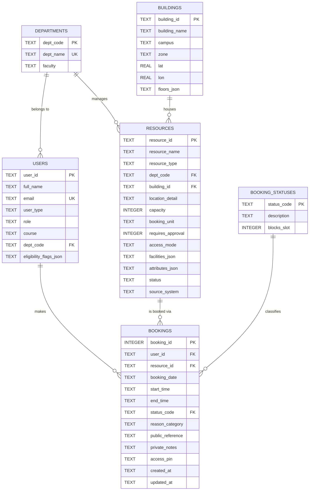

# Domain Model & Database Schema

## 1. Overview & ERD

The **Campus Learning Resources Booking System** centralises reservations across University of Warwick campuses using **4 actors** and **6 normalised (3NF) relational entities** in SQLite3 (`PRAGMA foreign_keys = ON`), grounded in Warwick's real multi-portal data (Central Timetabling WRB, Library Spaces & RoomBooking, IDG Work Areas, Laptop Loans, myAdvantage, and MazeMap).

### Actors

| Actor (`role`) | Primary Scope | Access & Privacy Model |
| :--- | :--- | :--- |
| `admin` | Full system management (departments, users, resources, bookings, seed/import, overrides, analytics) | Unconstrained god-view; core system is built against this role first |
| `manager` *(Learning Resources Manager)* | Manage resource catalogue, create/update/approve/cancel bookings, view operational analytics | Full resource/booking operations; operational reporting |
| `student_services` *(Student Services Rep)* | Read-only access to availability, fairness across courses, and semester pressure trends | Pseudonymised student IDs, redacted free-text notes, small-cohort aggregation (`k >= 5`) |
| `member` *(Student / Staff)* | Browse available spaces, create bookings for self, reschedule or cancel own bookings | Ownership-scoped; `student` vs `staff` distinguished via `user_type` for quota rules |

### Core Entities

- **`departments`**: Academic and service units owning resources and users (organisational hierarchy; separate from physical buildings).
- **`buildings`**: Physical campus buildings with zone, WGS84 coordinates, and floor levels (sourced from Warwick MazeMap).
- **`users`**: Students and staff who book or administer resources.
- **`resources`**: Unified catalogue of all 5 resource types (study rooms, group spaces, computer labs, specialist equipment, academic support) with approval, access, and facility attributes.
- **`booking_statuses`**: Controlled lifecycle states with a `blocks_slot` flag for conflict detection.
- **`bookings`**: Central reservation records linking users, resources, time windows, statuses, public/private reason split, and optional door access PIN.

### Entity-Relationship Diagram (ERD)

---

## 2. Entity Schemas

### 2.1 `departments`

Stores university academic departments and central service units (organisational ownership, independent of physical buildings since one unit like Central Timetabling or Library spans multiple buildings).

| Column | Type | Constraints | Description |
| :--- | :--- | :--- | :--- |
| `dept_code` | `TEXT` | `PRIMARY KEY` | Short stable identifier (e.g. `WMG`, `CS`, `LIB`, `IDG`, `CENTRAL`) |
| `dept_name` | `TEXT` | `NOT NULL UNIQUE` | Official department or service name (from Warwick's 52-department directory) |
| `faculty` | `TEXT` | `NOT NULL` | Parent faculty/group (e.g. `Sci., Eng. and Med.`, `Arts`, `Social Sciences`, `Services`, `Cross faculty`) |

### 2.2 `buildings`

Stores physical campus buildings separately from `departments` to preserve 3NF and support campus-zone filtering and interactive map coordinates (sourced from Warwick MazeMap).

| Column | Type | Constraints | Description |
| :--- | :--- | :--- | :--- |
| `building_id` | `TEXT` | `PRIMARY KEY` | Stable building identifier (e.g. MazeMap ID `MM-1016749` or short code `ROOTES`, `FAB`, `ZEEMAN`) |
| `building_name` | `TEXT` | `NOT NULL` | Building name (e.g. `Rootes`, `Faculty of Arts Building`, `Main Library`) |
| `campus` | `TEXT` | `NOT NULL` | Campus name (`Central Campus`, `Innovation Campus Warwick`) |
| `zone` | `TEXT` | `NOT NULL CHECK (zone IN ('Main Site', 'Gibbet Hill Site', 'Westwood Site', 'Innovation Campus', 'Online'))` | Operational campus zone matching WRB zones |
| `lat` | `REAL` | `NULL` | WGS84 latitude (e.g. `52.378429`) |
| `lon` | `REAL` | `NULL` | WGS84 longitude (e.g. `-1.561232`) |
| `floors_json` | `TEXT` | `NOT NULL DEFAULT '[]'` | JSON list of floor labels (e.g. `["B","G","1","2"]`) |

### 2.3 `users`

Stores students, staff, and system operators. Separating `user_type` (academic affiliation) from `role` (system permissions) keeps RBAC clean and extensible.

| Column | Type | Constraints | Description |
| :--- | :--- | :--- | :--- |
| `user_id` | `TEXT` | `PRIMARY KEY` | University ID (e.g. `S1001`, `STF01`) |
| `full_name` | `TEXT` | `NOT NULL` | Display name |
| `email` | `TEXT` | `NOT NULL UNIQUE` | Institutional email |
| `user_type` | `TEXT` | `NOT NULL CHECK (user_type IN ('student', 'staff'))` | Distinguishes students from staff for quota/fairness logic |
| `role` | `TEXT` | `NOT NULL CHECK (role IN ('admin', 'manager', 'student_services', 'member'))` | Active RBAC role |
| `course` | `TEXT` | `NULL` | Degree programme for students (nullable for non-teaching staff); used in course-fairness analytics |
| `dept_code` | `TEXT` | `NOT NULL REFERENCES departments(dept_code) ON DELETE RESTRICT` | Owning department |
| `eligibility_flags_json` | `TEXT` | `NOT NULL DEFAULT '[]'` | JSON list of attribute flags for specialised access (e.g. `["pg_student"]`, `["disability_registered"]`) |

### 2.4 `resources`

Unified catalogue covering all 5 scenario resource categories while preserving real Warwick operational rules (auto-confirm vs pending approval, hourly vs multi-day loan, facility tags, and attribute-based eligibility).

| Column | Type | Constraints | Description |
| :--- | :--- | :--- | :--- |
| `resource_id` | `TEXT` | `PRIMARY KEY` | Unique resource code (e.g. `WRB-FAB1.05`, `LIB-GSR-2`, `WA-A0.01`, `EQ-LAP-01`, `SUP-MASP`) |
| `resource_name` | `TEXT` | `NOT NULL` | Human-readable label |
| `resource_type` | `TEXT` | `NOT NULL CHECK (resource_type IN ('study_room', 'computer_lab', 'specialist_equipment', 'academic_support', 'group_space'))` | Resource category |
| `dept_code` | `TEXT` | `NOT NULL REFERENCES departments(dept_code) ON DELETE RESTRICT` | Managing department or central service |
| `building_id` | `TEXT` | `NULL REFERENCES buildings(building_id) ON DELETE RESTRICT` | Physical building (`NULL` for online-only academic support sessions) |
| `location_detail` | `TEXT` | `NOT NULL` | Room number, floor, locker location, or `Online (MS Teams)` |
| `capacity` | `INTEGER` | `NOT NULL CHECK (capacity > 0)` | Max seats, PCs, or concurrent loan units |
| `booking_unit` | `TEXT` | `NOT NULL DEFAULT 'hourly' CHECK (booking_unit IN ('hourly', 'daily'))` | `hourly` for rooms/labs/support slots; `daily` for up-to-7-day equipment loans |
| `requires_approval` | `INTEGER` | `NOT NULL DEFAULT 0 CHECK (requires_approval IN (0, 1))` | `1` starts booking as `pending` (e.g. Central WRB rooms); `0` auto-confirms (e.g. Library Group Study) |
| `access_mode` | `TEXT` | `NOT NULL DEFAULT 'open' CHECK (access_mode IN ('open', 'pin', 'card_checkin', 'staff_only', 'pg_only', 'disability_only'))` | Real Warwick access/eligibility rule for the resource |
| `facilities_json` | `TEXT` | `NOT NULL DEFAULT '[]'` | JSON list of AV/equipment tags (e.g. `["Data Projector", "Lecture Capture", "Teams Enhanced AV"]`) |
| `attributes_json` | `TEXT` | `NOT NULL DEFAULT '{}'` | Type-specific extensible fields (e.g. `room_layout`, `linux`, `max_loan_days`, `noise_zone`, `info_url`) |
| `status` | `TEXT` | `NOT NULL DEFAULT 'active' CHECK (status IN ('active', 'maintenance', 'retired'))` | Operational availability; only `active` resources accept new bookings |
| `source_system` | `TEXT` | `NOT NULL DEFAULT 'manual'` | Provenance tag (`warwick_rooms`, `wrb`, `library`, `workareas`, `myadvantage`, `equipment`, `manual`) |

### 2.5 `booking_statuses`

Lookup table defining valid booking states and whether each state occupies a time slot during conflict checks.

| Column | Type | Constraints | Description |
| :--- | :--- | :--- | :--- |
| `status_code` | `TEXT` | `PRIMARY KEY CHECK (status_code IN ('confirmed', 'pending', 'cancelled', 'completed', 'no_show'))` | Lifecycle state |
| `description` | `TEXT` | `NOT NULL` | Human-readable meaning |
| `blocks_slot` | `INTEGER` | `NOT NULL CHECK (blocks_slot IN (0, 1))` | `1` for `confirmed` / `pending` (holds slot); `0` for `cancelled` / `completed` / `no_show` (slot free) |

### 2.6 `bookings`

Central transactional table storing all reservations, preserving status history for analytics, and mirroring Warwick WRB's public-vs-private note split plus Library's door-access PIN.

| Column | Type | Constraints | Description |
| :--- | :--- | :--- | :--- |
| `booking_id` | `INTEGER` | `PRIMARY KEY AUTOINCREMENT` | Surrogate booking identifier |
| `user_id` | `TEXT` | `NOT NULL REFERENCES users(user_id) ON DELETE RESTRICT` | User who made the reservation |
| `resource_id` | `TEXT` | `NOT NULL REFERENCES resources(resource_id) ON DELETE RESTRICT` | Booked resource |
| `booking_date` | `TEXT` | `NOT NULL` | ISO-8601 date (`YYYY-MM-DD`) |
| `start_time` | `TEXT` | `NOT NULL` | 24-hour start time (`HH:MM`) |
| `end_time` | `TEXT` | `NOT NULL CHECK (end_time > start_time)` | 24-hour end time (`HH:MM`), strictly after `start_time` |
| `status_code` | `TEXT` | `NOT NULL REFERENCES booking_statuses(status_code) ON DELETE RESTRICT` | Current booking state |
| `reason_category` | `TEXT` | `NOT NULL CHECK (reason_category IN ('individual_study', 'group_work', 'lab_practical', 'academic_support', 'equipment_loan', 'other'))` | Structured booking purpose for safe aggregation |
| `public_reference` | `TEXT` | `NULL` | Optional topic/module reference shown on timetable/room displays (mirrors WRB *Meaningful Reference* and Library *Topic*) |
| `private_notes` | `TEXT` | `NULL` | Optional private note visible only to `admin`/`manager`/owner; redacted for privacy-restricted roles (mirrors WRB *Other information*) |
| `access_pin` | `TEXT` | `NULL` | Optional 4-digit door PIN generated on confirmed `pin`-mode rooms (mirrors Library Group Study rooms) |
| `created_at` | `TEXT` | `NOT NULL DEFAULT (strftime('%Y-%m-%dT%H:%M:%SZ', 'now'))` | UTC creation timestamp |
| `updated_at` | `TEXT` | `NOT NULL DEFAULT (strftime('%Y-%m-%dT%H:%M:%SZ', 'now'))` | UTC last-modified timestamp |

### 2.7 Indexes, Integrity & Real-World Policy Rules

- **Indexes**:
  - `idx_bookings_resource_date ON bookings(resource_id, booking_date, status_code)` — accelerates slot conflict detection and availability lookups.
  - `idx_bookings_user_date ON bookings(user_id, booking_date, status_code)` — accelerates user double-booking checks and quota checks.
  - `idx_bookings_date ON bookings(booking_date)` — accelerates weekly trend and peak-time analytics.
  - `idx_resources_type_dept ON resources(resource_type, dept_code, status)` — accelerates catalogue browsing and availability filtering.
- **Conflict Rules**:
  - *Resource clash*: Reject if another booking on the same `resource_id` and `booking_date` with `blocks_slot = 1` satisfies `existing.start_time < new.end_time AND existing.end_time > new.start_time` (back-to-back adjacent slots are permitted).
  - *User clash*: Reject if the same `user_id` already holds an overlapping `blocks_slot = 1` booking on the same `booking_date`.
  - *Resource state*: Reject new bookings on resources whose `status != 'active'`.
- **Approval & Eligibility Rules**:
  - Creating a booking on a resource with `requires_approval = 1` defaults to `pending` (for `member`); `requires_approval = 0` defaults to `confirmed` (generating a 4-digit `access_pin` when `access_mode = 'pin'`).
  - `staff_only` resources reject `student` bookings (e.g. booking an entire IDG Work Area PC lab); `disability_only` and `pg_only` check `users.eligibility_flags_json` (admin can override).
- **Cancel vs Hard Delete**:
  - Standard cancellation updates `status_code = 'cancelled'` (releasing the slot while preserving data for cancellation-rate analytics).
  - Hard `DELETE` is reserved for `admin` housekeeping / data-erasure requests.
